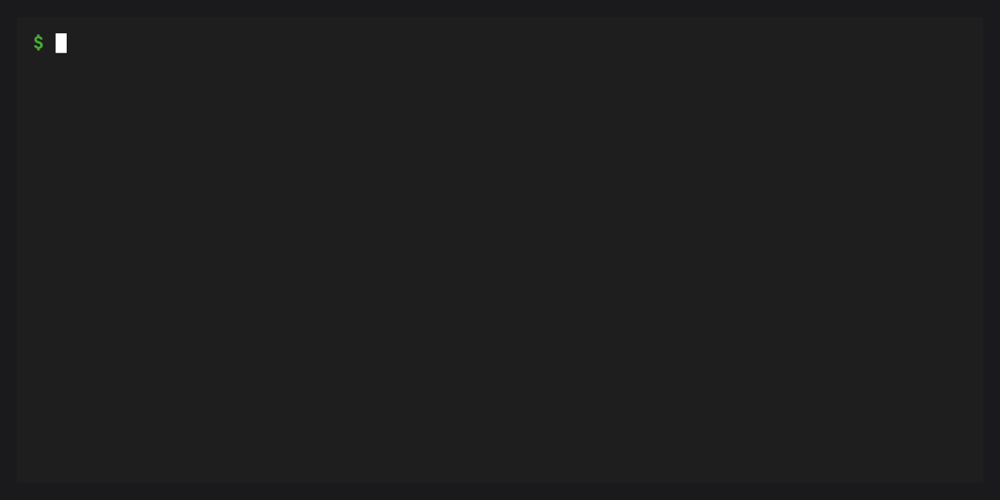

# Ship a workspace environment

`conda workspace ship` builds a native command-line launcher for an executable
supplied by a locked environment through
[conda-ship](https://github.com/conda-incubator/conda-ship). The launcher installs
the locked packages into its managed prefix on first use, then runs that
executable. Later invocations reuse the prefix.



````{important}
Install conda-ship 0.11.1 or later in the Python environment that runs conda:

```bash
conda install -n base "conda-forge::conda-ship>=0.11.1"
```

Replace `base` if conda runs from another environment.
The conda-forge builder package requires Python 3.11 or later in that environment.
````

## Prepare the manifest and lockfile

The selected environment must provide the executable you want to distribute.
For a Python launcher, add Python and the runtime settings to `conda.toml`:

```toml
[workspace]
name = "workspace-python"
channels = ["conda-forge"]
platforms = ["linux-64", "osx-arm64", "win-64"]

[dependencies]
python = "3.13.*"

[environments]
runtime = []

[tool.conda-ship]
runtime-name = "workspace-python"
runtime-version = "0.1.0"
delegate-executable = "python"
```

Generate `conda.lock` before building:

```bash
conda workspace lock
```

The ship command requires a current, complete `conda.lock`. It does not solve
dependencies, install a local workspace environment, or update the manifest
or lockfile. It passes the selected manifest and existing lockfile to
conda-ship, including when a Pixi-compatible manifest is used with a
conda-workspaces `conda.lock`.

## Build and run the launcher

Build for the native platform of the installed conda-ship runtime template.
For Linux x86-64:

```bash
conda workspace ship -e runtime --platform linux-64 -o dist
CONDA_SHIP_PREFIX="$PWD/.runtime" ./dist/workspace-python --version
```

The second command installs the locked Python environment into `.runtime` on
first use, then runs `python --version`. `CONDA_SHIP_PREFIX` selects the
launcher's managed prefix, independently of workspace environment prefixes.
Without an override, this configuration installs into
`~/.conda/workspace-python`. The `install-name` and `install-scheme` settings
can change that location. See conda-ship's
[install location reference](https://github.com/conda-incubator/conda-ship/blob/0.11.1/docs/explanation/install-locations-and-ownership.md).

Use `--platform osx-arm64` on Apple Silicon. On Windows x86-64, select
`win-64` and run the generated executable from PowerShell:

```powershell
conda workspace ship -e runtime --platform win-64 -o dist
$env:CONDA_SHIP_PREFIX = "$PWD/.runtime"
.\dist\workspace-python.exe --version
```

`--platform` selects locked package records. It does not cross-compile a
launcher. conda-ship rejects a platform that does not match its runtime
template. Named workspace platform variants are not supported by this
integration, including when an environment also declares an ordinary platform
with the same backing subdir. Select an environment with ordinary conda
platforms such as `linux-64`.

Set `--delegate-executable` to override the manifest's delegate. Arguments
passed to the resulting launcher go directly to that executable. The ship
command does not copy project source files or convert manifest tasks into
launcher commands. Applications must already be present in the locked packages
or distributed separately. Local path, Git, and URL PyPI dependencies are
unsupported. conda-ship also rejects package types it cannot install.

Workspace activation scripts and manifest activation variables are not copied
into the launcher. Runtime behavior is controlled by conda-ship.

The [shipping example](https://github.com/conda-incubator/conda-workspaces/tree/main/examples/ship)
contains this Python launcher configuration.

## Ship a packaged application

For an application launcher, lock the application's conda package and select
its executable as the delegate. For example, the
[conda-forge Ruff package](https://github.com/conda-forge/ruff-feedstock)
provides the `ruff` command. In a separate workspace, use:

```toml
[workspace]
name = "workspace-ruff"
channels = ["conda-forge"]
platforms = ["linux-64"]

[dependencies]
ruff = "*"

[environments]
runtime = []

[tool.conda-ship]
runtime-name = "workspace-ruff"
runtime-version = "0.1.0"
delegate-executable = "ruff"
```

Generate the lockfile, then build and run the launcher on Linux x86-64:

```bash
conda workspace lock
conda workspace ship -e runtime --platform linux-64 -o dist
./dist/workspace-ruff check path/to/project
```

Replace `path/to/project` with the code to check. The application comes from
the locked packages, while the files passed to Ruff remain outside the launcher.

## Choose where package archives live


`--artifact-layout` overrides `[tool.conda-ship].artifact-layout`. Without either
setting, conda-ship uses `online`.

| Layout | Build behavior | First invocation |
| --- | --- | --- |
| `online` | Writes a launcher without package archives | Downloads and installs locked packages |
| `external` | Downloads packages and writes a separate bundle | Installs packages from an extracted bundle directory |
| `embedded` | Downloads packages and embeds the bundle in the launcher | Extracts the bundle and installs its packages |

For a launcher that carries its package archives:

```bash
conda workspace ship -e runtime --platform linux-64 -o dist-embedded \
  --artifact-layout embedded
CONDA_SHIP_PREFIX="$PWD/.runtime-embedded" ./dist-embedded/workspace-python --version
```

Bundle builds download packages but do not install a workspace environment.
Every layout installs a managed prefix when the launcher first runs.

For an external bundle, build the launcher and archive:

```bash
conda workspace ship -e runtime --platform linux-64 -o dist-external \
  --artifact-layout external
```

The recipient extracts the archive, then points the launcher at that directory:

```bash
mkdir packages
tar -xf dist-external/workspace-python.bundle.tar.zst -C packages
WORKSPACE_PYTHON_BUNDLE="$PWD/packages" WORKSPACE_PYTHON_OFFLINE=1 \
  CONDA_SHIP_PREFIX="$PWD/.runtime-external" \
  ./dist-external/workspace-python --version
```

Extraction requires `tar` with Zstandard support. `WORKSPACE_PYTHON_BUNDLE`
names a directory containing package archives. `WORKSPACE_PYTHON_OFFLINE=1`
selects conda-ship's offline bootstrap mode. In conda-ship 0.11.1, offline mode
can still download missing packages. Supply the complete bundle and test with
network access disabled when preparing an offline deployment.

These variable names derive from `runtime-name`, so change them if you rename
the runtime. See the
[conda-ship runtime reference](https://github.com/conda-incubator/conda-ship/blob/0.11.1/docs/reference/runtime-cli.md#bootstrap-controls)
for other runtimes. Embedded launchers locate their package bundle automatically.

## Distribute and maintain the launcher

Publish the complete output directory, including the launcher, checksums,
runtime lock, package list, SBOM, build metadata, and external bundle when
present. Recipients run `workspace-python` or `workspace-python.exe` on a
compatible operating system and architecture. They need any system libraries
required by the locked packages and a writable, persistent managed prefix.
They do not need conda, conda-workspaces, or the conda-ship builder installed.

Online launchers need access to the locked package URLs for the first
installation. Embedded launchers carry their package archives. External
launchers need the extracted bundle directory configured above. After a
successful installation, later invocations reuse the managed prefix.

A ready prefix can be reused after replacing the launcher, even when its
locked packages or `runtime-version` have changed. Rebuilding alone does not
refresh the packages already installed there. For a new prefix when the
version or runtime lock changes, add this setting to `[tool.conda-ship]`:

```toml
install-name = { from = "runtime-lock", base = "workspace-python" }
```

This derives the install directory from the base name, version, and runtime
lock hash. Older prefixes remain on disk. A fixed `CONDA_SHIP_PREFIX` or
runtime-specific prefix override bypasses that directory selection. Leave
these overrides unset for derived names, or choose a fresh explicit prefix
when testing a rebuilt launcher. The derived setting cannot be combined with
`[tool.conda-ship.update]`.

Plan executable updates and removal through your distribution's installer or
package manager. Launcher arguments such as `uninstall` go to the delegate.
See conda-ship's
[lifecycle guidance](https://github.com/conda-incubator/conda-ship/blob/0.11.1/docs/explanation/install-locations-and-ownership.md#lifecycle-commands)
and [packaging guide](https://github.com/conda-incubator/conda-ship/blob/0.11.1/docs/how-to/package-a-runtime.md).
Before release, follow its
[artifact verification and signing guide](https://github.com/conda-incubator/conda-ship/blob/0.11.1/docs/how-to/verify-release-artifacts.md).
The workspace command builds artifacts. Publishing, product signing, and
cleanup of older prefixes remain part of your release process.

## Preview a build

```bash
conda workspace ship -e runtime --platform linux-64 -o dist --dry-run --json
```

`--dry-run` validates the workspace selection and shows conda-ship's build
plan on stderr without downloading packages or writing artifacts. With
`--json`, stdout contains the status fields `success`, `environment`,
`platform`, `output`, and `dry_run`. It does not contain the detailed build
plan. A successful preview does not prove that the runtime template matches
the selected platform, that packages can be downloaded, or that the delegate
will start. Build and test the launcher with a fresh prefix before release.

Use the global `--file` option when several manifests exist:

```bash
conda workspace --file pyproject.toml ship -e runtime \
  --platform linux-64 -o dist
```

The selected manifest's `[tool.conda-ship]` settings control runtime naming,
version, delegate, and other conda-ship build policy. `-e` selects the source
environment for this build.

## Choose a delivery format

| Command | Result | When packages are installed |
| --- | --- | --- |
| `workspace ship` | Native launcher for a locked environment | On the launcher's first invocation |
| `workspace image` | Linux container image with environment and project files | During the image build |
| `workspace archive` | Workspace snapshot, optionally with package archives | During a separate installation after extraction |

Use [images](image.md) when the application needs copied project files and a
container runtime. Use [archives](../features/archives.md) to transfer a
workspace for further work or installation.
